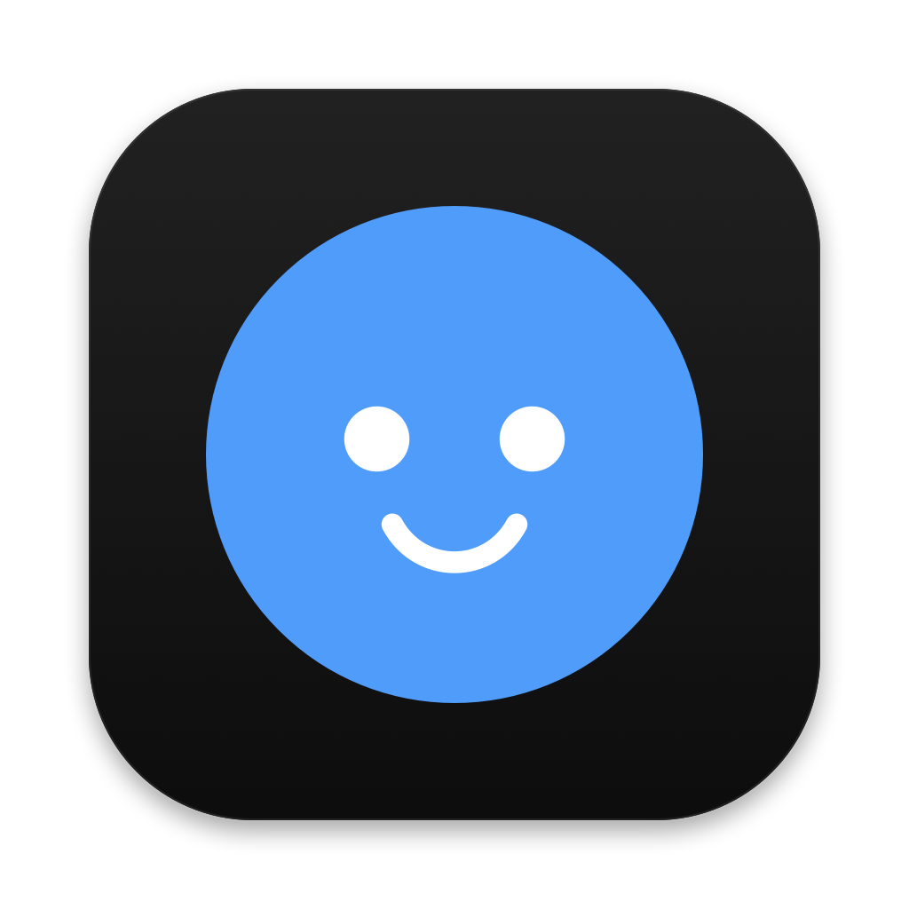

<p align="center">
  
</p>

<h1 align="center">Local Bot</h1>

<p align="center">
  AI bots that work on their own computers, right on your Mac.<br>
  <a href="https://github.com/patrick-mns/localbot/releases/latest">Download</a>
</p>

A local take on Grok Bot: AI bots that work on their own computers, with you
watching (and taking over) live. No cloud: you are the cloud.

- **Devices** are the machines bots work on: Linux desktops in Docker
  ([Cua](https://github.com/trycua/cua)'s `xfce-cua` image) or macOS VMs via
  [Lume](https://github.com/trycua/cua/tree/main/libs/lume). Simulators and
  remote machines are planned.
- **Bots** have a role, instructions, a model and a face. A bot owns a device
  or shares one as a guest.
- **Hands**: bots operate their device through
  [Cua Driver](https://github.com/trycua/cua/tree/main/libs/cua-driver)
  (screenshots, clicks, typing, shell), in an agent loop.
- **Models**: any OpenAI-compatible provider (OpenRouter, OpenAI, Anthropic,
  xAI, Gemini, Groq, Ollama, LM Studio, custom URL).

## Layout

```
brain/      TypeScript, cross-platform: bots, chat, agent loop, devices, providers
apps/mac/   Swift shell for macOS: window, device screen, native VM display
scripts/    dev helpers
```

The shell starts the brain and talks to it over JSON lines on stdio. Logic
lives in the brain so Windows/Linux shells can reuse it.

## Install

Download `LocalBot-<version>.dmg` from
[Releases](https://github.com/patrick-mns/localbot/releases), open it and drag
**Local Bot** to Applications.

Requirements: a Mac with Apple silicon and macOS 14+, and
[Docker Desktop](https://www.docker.com/products/docker-desktop/) running
(bots' Linux computers run in Docker).

The app isn't signed with an Apple Developer ID yet, so the first time macOS
blocks it: open **System Settings → Privacy & Security** and click
**Open Anyway** next to "Local Bot" (or run
`xattr -dr com.apple.quarantine "/Applications/Local Bot.app"`). After that it
opens normally.

On first launch a setup assistant connects an AI provider (your key goes to the
macOS Keychain), creates a Linux device and your first bot.

## Build from source (macOS, Apple silicon)

Requirements: Node 22+, Swift 6 (Xcode 16), Docker Desktop.

```bash
scripts/dev-mac.sh          # run from source
(cd brain && npm run check) # typecheck + tests
scripts/build-app.sh        # dist/Local Bot.app and dist/LocalBot-<version>.dmg
```

macOS VM devices (Lume) are experimental and off by default; set
`LOCALBOT_EXPERIMENTAL_MACOS=1` to try them.

Local state (bots, chats, memory, routines) lives in `~/.local-bot`; API keys
live in the macOS Keychain. Logs: `~/Library/Logs/LocalBot/brain.log`.

## License

MIT, see [LICENSE](LICENSE).
